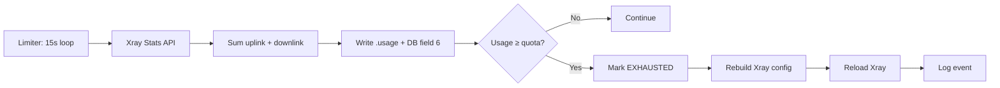

🔷 DNSTT + V2Ray (Xray) Backend — Complete Edition

<p align="center">
  
  
  
  
</p>

<p align="center">
  <b>Production-grade DNS tunneling panel with V2Ray (Xray) backend</b><br>
  Per-user bandwidth enforcement • Dynamic HTML banners • Trial accounts • 7-level speed boosters
</p>

<p align="center">
  <a href="#-quick-install"><b>⚡ Quick Install</b></a> •
  <a href="#-features"><b>✨ Features</b></a> •
  <a href="#-architecture"><b>🏗️ Architecture</b></a> •
  <a href="#-menu-guide"><b>🎛️ Menu</b></a> •
  <a href="#-troubleshooting"><b>🔧 Troubleshooting</b></a>
</p>

---

⚡ Quick Install

One-liner (recommended):

```bash
bash <(curl -sL https://raw.githubusercontent.com/VOLTRON-TECH-X/dnst-v2rays/refs/heads/main/install.sh)
```

⚠️ Run as root. On a fresh Debian/Ubuntu VPS. The installer handles dependencies automatically.

After install, launch the panel:

```bash
dnstt-v2ray
```

Or manually:

```bash
bash /root/dnstt-v2ray.sh
```

---

🎯 What is this?

A single-script control panel for running a DNS tunnel (via DNSTT) with a modern proxy backend (V2Ray / Xray). It handles:

· 🔐 DNS tunneling over port 53 — bypasses deep packet inspection
· 🚀 V2Ray (Xray) backend — VLESS / VMess / Trojan protocols
· 📊 Per-user bandwidth quotas enforced via Xray Stats API
· 🎨 Dynamic HTML banners rendered per user on login
· ⏱️ Trial accounts with automatic cleanup
· ⚡ 7 speed booster levels with sysctl tuning

Designed for ISPs, VPN resellers, network engineers who need enterprise-grade user management without a database or web framework.

---

✨ Features

<table>
<tr>
<td width="50%">

🔷 Core

· DNS tunneling via DNSTT
· V2Ray (Xray) backend
· VLESS / VMess / Trojan — switchable
· Auto-domain via deSEC API
· Custom domains supported
· Configurable MTU (512–1500)

👤 User Management

· Create / Delete / Edit / List
· Bulk create (up to 100 users)
· Lock / Unlock accounts
· Renew (extend expiry)
· Auto-cleanup of expired accounts
· Trial accounts (1h–3d)

</td>
<td width="50%">

📊 Bandwidth & Enforcement

· Per-user quota (GB)
· Real-time tracking via Xray Stats API
· Auto-lock on exhaustion
· Session limit enforcement
· Progress bar with smart formatter
· Status priority: LOCKED → EXPIRED → EXHAUSTED → ACTIVE

🎨 Banners & System

· Dynamic HTML banners per user
· Color-coded progress bars
· Live server stats (uptime, load)
· Systemd services for all components
· Auto-restart on failure
· Full logging + lock file

</td>
</tr>
</table>

---

🏗️ Architecture

```
┌─────────────────────────────────────────────────────────────────┐
│                    CLIENT (SlipNet + Nekobox)                   │
│                                                                 │
│   ┌──────────────┐    DNS     ┌──────────────────────────┐      │
│   │   SlipNet    │ ─────────▶ │  DNSTT Server (Port 53)  │      │
│   │  (DNSTT)     │            │  Downstream: 5300/UDP    │      │
│   └──────────────┘            └────────────┬─────────────┘      │
│                                            │                    │
│                                            ▼                    │
│                              ┌──────────────────────────┐       │
│                              │  V2Ray (Xray) Backend    │       │
│                              │  127.0.0.1:10086         │       │
│                              │  Protocol: VLESS/VMess   │       │
│                              └────────────┬─────────────┘       │
│                                            │                    │
│                                            ▼                    │
│                              ┌──────────────────────────┐       │
│                              │  Xray Stats API          │       │
│                              │  127.0.0.1:10085         │       │
│                              └────────────┬─────────────┘       │
│                                            │                    │
│                                            ▼                    │
│                              ┌──────────────────────────┐       │
│                              │  V2Ray Limiter (15s)     │       │
│                              │  • Read stats            │       │
│                              │  • Update DB             │       │
│                              │  • Enforce quotas        │       │
│                              │  • Rebuild Xray config   │       │
│                              └──────────────────────────┘       │
└─────────────────────────────────────────────────────────────────┘
```

Data flow:

1. Client resolves DNS → SlipNet tunnels packet through DNS
2. DNSTT server receives packet on port 53/5300
3. DNSTT forwards decapsulated TCP to V2Ray on 127.0.0.1:10086
4. V2Ray proxies traffic to the internet
5. Limiter polls Xray Stats API every 15s → updates DB → enforces quotas

---

📋 Requirements

Item Minimum Recommended
OS Debian 10 / Ubuntu 20.04 Debian 12 / Ubuntu 22.04
RAM 512 MB 1 GB+
CPU 1 vCPU 2+ vCPU
Disk 5 GB 10 GB+
Access Root Root
IP Public IPv4 Public IPv4
Ports 53/UDP, 5300/UDP, 22/TCP Same

Optional:

· Domain with NS delegation (for custom domains)
· deSEC account (for auto-domain generation)

---

🚀 Installation

Method 1 — One-liner (Recommended)

```bash
bash <(curl -sL https://raw.githubusercontent.com/VOLTRON-TECH-X/dnst-v2rays/refs/heads/main/install.sh)
```

Method 2 — Manual download

```bash
wget -O /root/dnstt-v2ray.sh https://raw.githubusercontent.com/VOLTRON-TECH-X/dnst-v2rays/refs/heads/main/install.sh
chmod +x /root/dnstt-v2ray.sh
sudo bash /root/dnstt-v2ray.sh
```

Method 3 — Verify before running

```bash
curl -sL https://raw.githubusercontent.com/VOLTRON-TECH-X/dnst-v2rays/refs/heads/main/install.sh -o /tmp/install.sh
sha256sum /tmp/install.sh
sudo bash /tmp/install.sh
```

After Install

1. Launch the panel:

```bash
dnstt-v2ray
```

2. Install DNSTT + V2Ray backend:

```
Main Menu → [13] Install DNSTT + V2Ray
```

Follow the prompts:

· Protocol → VLESS (recommended) / VMess / Trojan
· V2Ray port → default 10086
· MTU → 512 (default) / 900 / 1200 / 1400 / 1500
· Domain → custom or auto-generated via deSEC

3. Verify services:

```bash
systemctl status dnstt
systemctl status v2ray-dnstt
systemctl status v2ray-limiter
```

All three should show active (running).

4. Create your first user:

```
Main Menu → [1] Create User
```

5. Get client config:

```
Main Menu → [11] Client Config
```

---

🎛️ Menu Guide

```
╔══════════════════════════════════════════════════════════════════╗
║          DNSTT + V2RAY (XRAY) BACKEND — MAIN MENU                ║
╚══════════════════════════════════════════════════════════════════╝

  📊 Server Status
  ─────────────────────────────────────────────────────────
  DNSTT: ●   V2Ray: ●   Limiter: ●
  Domain : tun-abc.voltrontechtx.shop
  Users  : 42

  🔷 V2RAY USER MANAGEMENT
  ─────────────────────────────────────────────────────────
  [ 1] Create User              [ 7] Renew User
  [ 2] Delete User              [ 8] Cleanup Expired
  [ 3] Edit User                [ 9] Bulk Create
  [ 4] Lock User                [10] View Bandwidth
  [ 5] Unlock User              [11] Client Config
  [ 6] List Users               [12] Trial Account

  🔧 SYSTEM & BACKEND
  ─────────────────────────────────────────────────────────
  [13] Install DNSTT + V2Ray    [17] Speed Boosters
  [14] DNSTT Management         [18] VPS Dashboard
  [15] V2Ray Backend            [19] System Utilities
  [16] Sync V2Ray Config        [20] Dynamic Banner

  ─────────────────────────────────────────────────────────
  [99] Uninstall All            [ 0] Exit
```

Option Reference

# Action Description
1 Create User Create V2Ray user with UUID, expiry, limit, bandwidth
2 Delete User Bulk delete (comma-separated, all)
3 Edit User Change UUID / expiry / limit / bandwidth / reset usage
4 Lock User Set status to LOCKED → removed from Xray config
5 Unlock User Set status to ACTIVE → restored to Xray config
6 List Users Full list with status, bandwidth bar, days left
7 Renew User Extend expiry by N days
8 Cleanup Expired Delete all accounts past expiry
9 Bulk Create Create N users with prefix (e.g., user1, user2)
10 View Bandwidth Detailed per-user bandwidth view
11 Client Config Show DNSTT + V2Ray client settings
12 Trial Account 1h / 2h / 3h / 6h / 12h / 1d / 3d with auto-delete
13 Install Full DNSTT + V2Ray installation
14 DNSTT Mgmt Domain, keys, MTU, speed boosters, details
15 V2Ray Backend Restart, logs, protocol, port, sync
16 Sync Config Force rebuild Xray config from DB
17 Speed Boosters 7 sysctl tuning levels
18 VPS Dashboard RAM, CPU, disk, swap, services
19 System Utilities Backup, restore, cache cleaner
20 Dynamic Banner Enable / disable / refresh SSH banners
99 Uninstall Full system removal
0 Exit Quit panel

---

👤 User Management

Database Format

Users are stored in /etc/dnstt-v2ray/v2ray_users.db as colon-separated values:

```
username:uuid:expiry:limit:bandwidth_gb:traffic_gb:status
```

Example:

```
alice:3f2a1b4c-...-9e8d:2025-12-31:999:50:12.3456:ACTIVE
bob:8a7b6c5d-...-1f2e:2025-06-15:10:0:0.0000:LOCKED
```

Field Description
username Unique username (no : allowed)
uuid UUID (VLESS/VMess) or password (Trojan)
expiry Date in YYYY-MM-DD format
limit Max concurrent sessions (0 = unlimited)
bandwidth_gb Quota in GB (0 = unlimited)
traffic_gb Current usage (auto-updated by limiter)
status ACTIVE / LOCKED / EXPIRED / EXHAUSTED

Status Priority

When displaying a user, status is computed in this order:

Priority Status Condition
1 🔒 LOCKED Manually locked via menu
2 🗓️ EXPIRED Expiry date passed
3 📦 EXHAUSTED Bandwidth quota exceeded
4 ✅ ACTIVE Everything else

Creating a User

```
Main Menu → [1] Create User

Username: alice
UUID: [1] Auto-generate
Expiry (days) [30]: 30
Connection limit [999]: 5
Bandwidth GB (0=unlimited) [0]: 50
```

Result:

· DB entry appended
· .usage file created (0 bytes)
· Xray config rebuilt + reloaded
· Client config shown on screen

---

📊 Bandwidth Enforcement

How It Works



Steps:

1. Limiter (v2ray-limiter.sh) runs every 15 seconds
2. For each user, queries Xray Stats API:
   ```bash
   xray api statsquery --server=127.0.0.1:10085 \
       -pattern "user>>>alice@dnstt>>>traffic>>>uplink"
   ```
3. Sums uplink + downlink → writes to:
   · .usage file (bytes)
   · DB field 6 (GB)
4. If usage ≥ quota:
   · DB status → EXHAUSTED
   · Xray config rebuilt (user removed)
   · Xray reloaded
   · Log entry written to /var/log/v2ray-limiter.log

Bandwidth Bar

```
BW: ████████░░ 80.0% | 40.00 GB/50.00 GB
```

Color-coded:

Range Color Meaning
< 60% 🟢 Green Safe
60–80% 🟡 Yellow Watch
80–95% 🟠 Orange Warning
≥ 95% 🔴 Red Critical

Reset Usage

```
Main Menu → [3] Edit User → select user → [5] Reset Bandwidth
```

---

🎨 Dynamic Banners

What It Does

Renders an HTML banner per user, shown on SSH login (for SSH-based deployments) or in V2Ray client (via API integration).

Content

· Header — 🔷 VOLTRON V2RAY 🔷
· Username — current user
· Expiration — date
· Bandwidth — progress bar with %, used/limit, remaining
· Sessions — current/limit
· Status — ACTIVE / LOCKED / EXPIRED / EXHAUSTED
· Server uptime + load
· Community links (Telegram)
· Notice (no torrent, no sharing)

State Colors

Status Color
ACTIVE 🟢 Green #6BCB77
EXPIRING SOON 🟡 Yellow #FFD93D
EXPIRING 🟠 Orange #FF9F43
EXPIRES TODAY 🔴 Red #FF6B6B
LOCKED / EXHAUSTED 🔴 Red #FF6B6B
EXPIRED 🟠 Orange #FF9F43

Enable / Disable

```
Main Menu → [20] Dynamic Banner

[1] Enable
[2] Disable
[3] Refresh/Regenerate All
[4] Preview User Banner
```

Banners stored at: /etc/dnstt-v2ray/banners/v2ray_<user>.txt

---

⚡ Speed Boosters

7 levels of sysctl tuning, all including TCP Fast Open + BBR + fq:

# Level Buffer Use Case
1 Standard 512 Low-end VPS
2 Medium 5120 General use
3 High 51200 High-traffic
4 ⭐ Ultra 512000 Recommended
5 Extreme 5120000 Heavy load
6 Ultra Plus 6291456 (768MB) Large RAM
7 Extreme+ 12582912 (1GB) Very large RAM

Apply

```
Main Menu → [17] Speed Boosters
[1–7] Select level
```

View / Reset

```
[8] View Current Settings    ← shows TCP CC, TFO, QDisc, buffers
[9] Reset to Default          ← reverts to cubic + fq_codel
```

---

📱 Client Setup

Prerequisites

· SlipNet (DNSTT client) — Android / iOS / Desktop
· Nekobox or v2rayNG — V2Ray client

Step 1 — Get Settings

```
Main Menu → [11] Client Config
```

Shows:

· DNSTT Tunnel — domain, public key, MTU, DNS resolver
· V2Ray Protocol — protocol, address, port, UUID, encryption

Step 2 — Configure SlipNet

Field Value
Mode Proxy Only
Domain <your-tunnel-domain>
Public Key <from config>
DNS Resolver 8.8.8.8:53
MTU 512 (or as configured)
SOCKS Port 1080

Step 3 — Configure Nekobox

Outbound:

Field Value
Type SOCKS5
Address 127.0.0.1
Port 1080

V2Ray Protocol:

Field Value
Protocol VLESS / VMess / Trojan
Address 127.0.0.1
Port <from config, default 10086>
UUID <from config>
Encryption none
Transport tcp
Security none

Routing:

Rule Action
127.0.0.1/32 Direct

Step 4 — Connect

1. Start SlipNet first (establishes DNS tunnel)
2. Start Nekobox (uses SOCKS5 tunnel)
3. Browse normally

---

📂 File Structure

```
/etc/dnstt-v2ray/
├── .install                    # Install flag
├── v2ray_users.db              # User database
├── v2ray_info.conf             # V2Ray runtime config
├── dnstt_info.conf             # DNSTT runtime config
├── domain.txt                  # Current tunnel domain
├── dnstt_upstream.txt          # Upstream (V2Ray port)
├── banners_enabled             # Dynamic banner flag
│
├── bandwidth/                  # Per-user usage (bytes)
│   └── v2ray_<user>.usage
│
├── banners/                    # Per-user HTML banners
│   └── v2ray_<user>.txt
│
├── config/
│   └── mtu                     # Current MTU
│
├── dnstt/                      # DNSTT keys
│   ├── server.key
│   └── server.pub
│
├── logs/                       # Xray + DNSTT logs
│   └── v2ray-error.log
│
└── v2ray/
    └── config.json             # Xray config (auto-generated)

/usr/local/bin/
├── dnstt-server                # DNSTT binary
├── dnstt-client                # DNSTT client
├── xray                        # Xray binary
├── v2ray-limiter.sh            # Limiter script
├── v2ray-banner-build.sh       # Banner builder
└── dnstt-v2ray-trial-cleanup.sh

/etc/systemd/system/
├── dnstt.service
├── v2ray-dnstt.service
└── v2ray-limiter.service

/var/log/
└── v2ray-limiter.log           # Limiter log
```

---

🔧 Troubleshooting

Limiter not enforcing

```bash
systemctl status v2ray-limiter
journalctl -u v2ray-limiter -n 50 --no-pager
tail -50 /var/log/v2ray-limiter.log
```

Check Xray Stats API:

```bash
/usr/local/bin/xray api statsquery --server=127.0.0.1:10085 \
    -pattern "user>>>alice@dnstt>>>traffic>>>uplink"
```

Should return:

```json
{
  "stat": [
    {
      "name": "user>>>alice@dnstt>>>traffic>>>uplink",
      "value": "12345"
    }
  ]
}
```

Bandwidth not updating

· Check .usage file: cat /etc/dnstt-v2ray/bandwidth/v2ray_alice.usage
· Check DB field 6: grep "^alice:" /etc/dnstt-v2ray/v2ray_users.db
· Ensure Xray is running: systemctl status v2ray-dnstt

Locked user still active

· Cause: Xray config not rebuilt
· Fix: Main Menu → [16] Sync V2Ray Config
· Limiter does this automatically every 15s when dirty=1

DNSTT not starting

```bash
journalctl -u dnstt -n 50 --no-pager
```

Common issues:

Issue Fix
Port 53 in use systemctl stop systemd-resolved
Invalid public key Main Menu → [14] → [2] → [2] (regenerate)
Domain NS not propagated Wait 5–30 minutes

Xray config invalid

```bash
/usr/local/bin/xray -test -c /etc/dnstt-v2ray/v2ray/config.json
```

Rebuild:

```
Main Menu → [16] Sync V2Ray Config
```

Reset everything

```bash
# Backup first
Main Menu → [19] System Utilities → [1] Backup Users

# Then uninstall
Main Menu → [99] Uninstall All
```

---

🗑️ Uninstall

Full uninstall (via menu)

```
Main Menu → [99] Uninstall All
Type: YES
```

Removes:

· ✅ All systemd services (dnstt, v2ray-dnstt, v2ray-limiter)
· ✅ All binaries (dnstt-server, xray, limiter, banner builder)
· ✅ /etc/dnstt-v2ray/ directory
· ✅ iptables rules
· ✅ Cron jobs
· ✅ The script itself

Manual cleanup

```bash
systemctl stop dnstt v2ray-dnstt v2ray-limiter
systemctl disable dnstt v2ray-dnstt v2ray-limiter
rm -rf /etc/dnstt-v2ray
rm -f /usr/local/bin/xray /usr/local/bin/v2ray-limiter.sh
systemctl daemon-reload
```

---

📝 Changelog

v1.0.1 — Limiter Fix ⭐

· 🐛 FIXED: Limiter ported from VOLTRON v10.18 logic
· 🐛 FIXED: Status priority LOCKED → EXPIRED → EXHAUSTED → ACTIVE
· 🐛 FIXED: Auto-rebuild Xray config on dirty=1
· 🐛 FIXED: Bandwidth from Xray Stats API (email-based)
· ✨ ADDED: Lock file (flock)
· ✨ ADDED: Logging at /var/log/v2ray-limiter.log
· ✨ ADDED: Trap SIGTERM/SIGINT
· ✨ ADDED: Non-destructive firewall (iptables -C)
· ✨ ADDED: curl -fsL for binary downloads

v1.0.0 — Initial Release

· DNSTT + V2Ray (VLESS / VMess / Trojan)
· Auto-domain via deSEC
· Custom MTU (512–1500)
· Per-user bandwidth enforcement
· Dynamic HTML banners
· Trial accounts
· 7 speed booster levels
· Full VPS dashboard
· Backup / restore

---

🙏 Credits

Project Link
DNSTT https://dnstt.network
Xray-core https://github.com/XTLS/Xray-core
deSEC https://desec.io

---

📄 License

```
MIT License

Copyright (c) 2025 Voltron Tech

Permission is hereby granted, free of charge, to any person obtaining a copy
of this software and associated documentation files (the "Software"), to deal
in the Software without restriction, including without limitation the rights
to use, copy, modify, merge, publish, distribute, sublicense, and/or sell
copies of the Software, and to permit persons to whom the Software is
furnished to do so, subject to the following conditions:

The above copyright notice and this permission notice shall be included in all
copies or substantial portions of the Software.

THE SOFTWARE IS PROVIDED "AS IS", WITHOUT WARRANTY OF ANY KIND, EXPRESS OR
IMPLIED, INCLUDING BUT NOT LIMITED TO THE WARRANTIES OF MERCHANTABILITY,
FITNESS FOR A PARTICULAR PURPOSE AND NONINFRINGEMENT. IN NO EVENT SHALL THE
AUTHORS OR COPYRIGHT HOLDERS BE LIABLE FOR ANY CLAIM, DAMAGES OR OTHER
LIABILITY, WHETHER IN AN ACTION OF CONTRACT, TORT OR OTHERWISE, ARISING FROM,
OUT OF OR IN CONNECTION WITH THE SOFTWARE OR THE USE OR OTHER DEALINGS IN THE
SOFTWARE.
```

---

<p align="center">
  <b>Built with ❤️ by Voltron Tech</b><br><br>
  <a href="https://t.me/voltrontech">📱 Telegram</a> •
  <a href="https://github.com/VOLTRON-TECH-X/dnst-v2rays">💻 GitHub</a> •
  <a href="https://github.com/VOLTRON-TECH-X/dnst-v2rays/issues">🐛 Issues</a>
</p>

<p align="center">
  ⭐ <b>Star this repo if you find it useful!</b> ⭐
</p>
